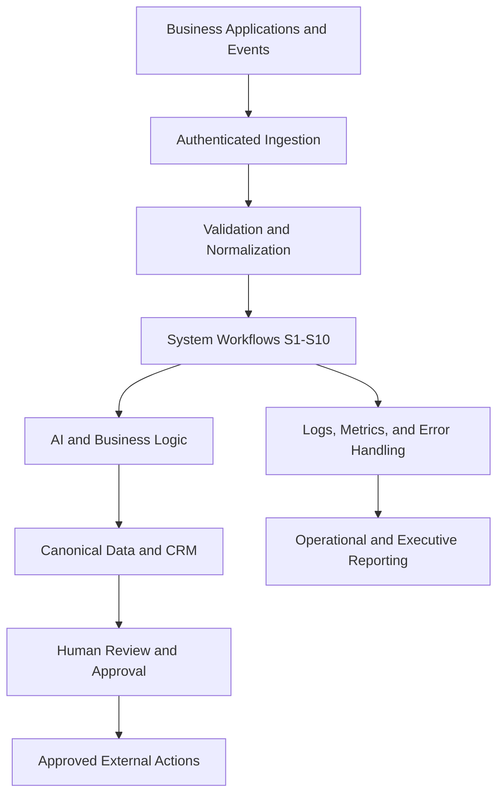

# STACKPROOF AI — Reference Architecture

## Purpose

STACKPROOF AI is being developed as a modular AI automation and business intelligence platform for business operations. Its objective is to reduce repetitive work, improve productivity, strengthen lead and CRM operations, and create measurable business value.

The architecture is organized as ten independently managed systems. Each system must have a defined purpose, inputs, outputs, dependencies, security controls, and acceptance criteria.

## System landscape

| ID | System | Primary responsibility | Current planning status |
|---|---|---|---|
| S1 | Lead Intelligence Engine | Discover, research, enrich, validate, qualify, score, deduplicate, and organize prospects | Existing core development (project directive) |
| S2 | CRM Command Centre | Synchronize CRM data and manage contact, lifecycle, pipeline, and sales activity records | Existing core development (project directive) |
| S3 | Personalized Outreach & Relationship Nurturing | Produce personalized, permission-aware outreach drafts for human review | Previously designed; production blockers remain |
| S4 | Sales Pipeline & Deal Intelligence | Validate opportunity events, classify deals, prevent duplicate processing, and route uncertainty for review | Previously designed; production blockers remain |
| S5 | Client Onboarding & Account Management | Verify approved closed-won events, create client records, and prepare onboarding drafts | Previously designed; production blockers remain |
| S6 | Customer Support & Service Intelligence | Organize support requests, assist responses, identify trends, and route escalations | Proposed |
| S7 | Appointment & Scheduling Command Centre | Coordinate appointment requests, availability, reminders, cancellations, and rescheduling | Proposed |
| S8 | Marketing & Campaign Intelligence | Support campaign planning, execution, measurement, and optimization | Proposed |
| S9 | Business Operations & Reporting | Monitor workflows, operational metrics, and recurring reports | Proposed |
| S10 | Executive Intelligence & Business Performance | Consolidate approved performance information for decision support | Proposed |

These statuses reflect the project directive. They are not independent verification of deployed functionality.

## Logical flow

The following is a conceptual view, not a deployed topology:

## Technology direction

The Master Engineering Directive identifies these preferred technologies for evaluation:

- n8n as the primary workflow automation platform.
- OpenAI and Anthropic Claude for AI capabilities.
- Google Workspace for productivity and business workflows.
- APIs and webhooks for application connectivity.
- PostgreSQL and Supabase for structured data and backend infrastructure.
- CRM platforms, including HubSpot.

These are technology priorities, not proof that every integration is configured, connected, or deployed.

## Cross-system design requirements

Every production-bound system must document:

1. Purpose, scope, and ownership.
2. Input contracts and validation rules.
3. Output contracts and downstream consumers.
4. Dependencies and failure behavior.
5. Authentication, authorization, and secret handling.
6. Idempotency and duplicate prevention.
7. Logging, monitoring, retries, and recovery.
8. Human approval requirements.
9. Functional and failure-path acceptance criteria.
10. Test evidence and deployment approval.

## System boundaries

Systems should remain independently understandable and testable. Shared data contracts and canonical records should be used where needed to prevent inconsistent state. Cross-system events should be authenticated, validated, traceable, and safe to process more than once.

## Architecture status

This document describes the intended reference architecture. It does not certify that the diagram represents a live deployment, nor that any proposed system is production-ready.
